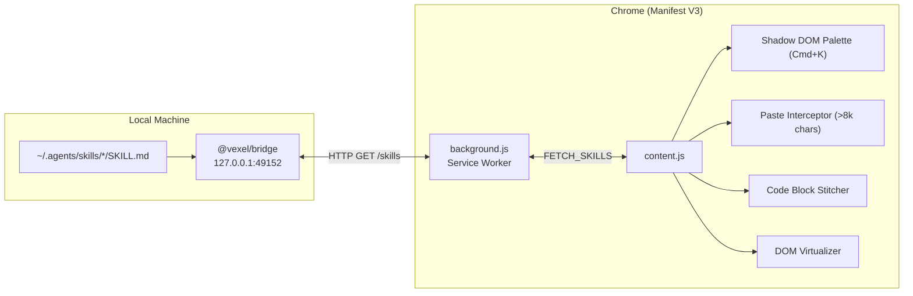

<div align="center">
  
  <p>
    <strong>A Chrome Manifest V3 extension and local skill bridge that removes input truncation, broken code blocks, and UI lag in Google AI Mode.</strong><br/>
    Vexel converts pastes over 8,000 characters into file attachments, injects local <code>~/.agents/skills</code> Markdown playbooks via a <code>Cmd+K</code> command palette, and repairs split code blocks directly from page metadata. Built as a zero-dependency Node.js bridge paired with a TypeScript content script for developers and power users working in long AI Mode threads on <code>google.com</code> and <code>google.fr</code>.
  </p>
  <p>
    <a href="https://github.com"></a>
    <a href="https://chrome.com"></a>
    <a href="https://nodejs.org"></a>
    <a href="https://typescriptlang.org"></a>
  </p>
  <p>
    <a href="#quickstart">Quickstart</a> •
    <a href="#features">Features</a> •
    <a href="#how-it-works">How it works</a> •
    <a href="#usage">Usage</a> •
    <a href="#status">Status</a>
  </p>
</div>

## Quickstart

Requires Node.js 20+, pnpm 10+, and Google Chrome (or any Chromium-based browser).

1. **Install dependencies and build both workspace packages:**

```bash
git clone git@github.com:elcoosp/vexel.git
cd vexel
pnpm install
pnpm build
```

```text
packages/extension build$ tsc && vite build
✓ 7 modules transformed.
dist/background.js   0.85 kB
dist/content.js     18.90 kB
✓ built in 15ms
packages/bridge build$ echo 'Bridge ready (native ESM)'
Bridge ready (native ESM)
```

2. **Load the unpacked extension in Chrome:**

- Open `chrome://extensions/` and enable **Developer mode**.
- Click **Load unpacked** and select `packages/extension/dist`.

3. **Start the local skills bridge:**

```bash
pnpm dev:bridge
```

```text
[Vexel Bridge] Pret sur http://127.0.0
```

4. **Open Google AI Mode** on `https://google.com` or `https://google.fr` and press `Cmd+K` (`Ctrl+K` on Linux/Windows) to open the skill palette.

## Features

- **Automatic paste-to-file conversion**: Intercepts pastes where `currentText + pastedText` exceeds `8,000` characters (`MAX_SAFE_LENGTH` in `untruncate.ts`) and attaches the payload as a timestamped `.txt` file via `DataTransfer` instead of letting the input truncate it.
- **Local skill palette with progressive disclosure**: Indexes Markdown skills from `~/.agents/skills/*/SKILL.md` over `http://127.0.0` and injects the core playbook plus a lightweight reference manifest on `Enter`, keeping context budgets small until specific reference files are requested.
- **Broken code block reconstruction**: Extracts raw code payloads from hidden `|||[[` page comments and stitches spilled DOM nodes that appear after Google's code-caution banner when Markdown parsing breaks mid-block.
- **Off-screen turn virtualization**: Applies `content-visibility: auto` and `contain-intrinsic-size: auto 320px` to all conversation turns except the four most recent ones, preventing input lag in long threads.
- **Zero-dependency bridge server**: Uses only `node:http`, `node:fs/promises`, `node:path`, and `node:os` in `packages/bridge/src/server.mjs` with no external runtime packages.

## How it works

Vexel splits responsibilities between a browser content script running on Google Search domains and a localhost HTTP bridge reading your local `~/.agents/skills` directory.



## Packages

| Package | Path | Role |
| --- | --- | --- |
| `@vexel/extension` | `packages/extension` | Chrome Manifest V3 extension built with TypeScript and Vite (`dist/content.js`, `dist/background.js`). |
| `@vexel/bridge` | `packages/bridge` | Native ESM Node.js HTTP server exposing `~/.agents/skills` on port `49152`. |

## Usage

### Command palette shortcuts

| Shortcut | Action |
| --- | --- |
| `Cmd+K` / `Ctrl+K` | Toggle the Vexel command palette. |
| `Enter` | Inject `SKILL.md` plus a lightweight index of files in `references/` (uploads as `.md` if over `8,000` characters). |
| `ArrowRight` | Drill into a skill's reference files (`.md`, `.txt`, `.yaml`, `.yml`, `.toml`, `.json`). |
| `ArrowLeft` | Return from reference view to the skill list when the search input is empty. |
| `Cmd+Enter` / `Ctrl+Enter` | Bundle `SKILL.md` together with the full content of every reference file in one payload. |
| `Escape` | Step back one level or close the palette. |

### Skill directory layout

Place each skill in its own folder under `~/.agents/skills/` with a `SKILL.md` entrypoint and optional nested reference files:

```text
~/.agents/skills/
└── create-readme/
    ├── SKILL.md
    └── references/
        └── examples.md
```

Optional YAML frontmatter (`name` and `description`) at the top of `SKILL.md` is parsed automatically for palette search and display.

## Status

> [!NOTE]
> Vexel is currently at `v0.1.0` (early active development). Tested on macOS with Node.js `v24.22.2`, pnpm `12.18.0`, and Google Chrome on `https://google.com` and `https://google.fr`.

- **Known limitations**: No automated test suite or GitHub Actions CI workflow is configured yet, and `docs/logo.png` must be committed to `main` for the header logo URL to render on GitHub.
- **Support**: Open an issue in [elcoosp/vexel](https://github.com) for bug reports or DOM selector updates when Google AI Mode markup changes.
