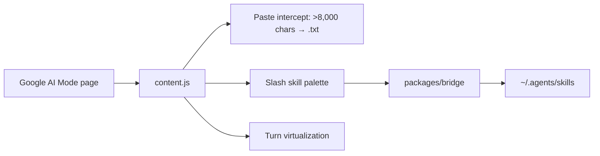

<div align="center">
  
  <p>
    <strong>A Chrome extension for developers that fixes Google AI Mode's paste truncation and UI lag.</strong><br/>
    Vexel intercepts clipboard pastes over 8,000 characters and converts them into file attachments before Google AI Mode can truncate them. It also virtualizes off-screen conversation turns so long sessions stay responsive, and a local bridge exposes your <code>~/.agents/skills/</code> playbooks through a palette. Built for multi-turn coding sessions on <code>google.com</code> and <code>google.fr</code>.
  </p>
  <p>
    <a href="https://github.com/elcoosp/vexel/blob/main/LICENSE"></a>
    <a href="https://developer.chrome.com/docs/extensions/develop/migrate"></a>
    <a href="https://nodejs.org"></a>
    <a href="https://www.typescriptlang.org"></a>
  </p>
  <p>
    <a href="#quickstart">Quickstart</a> •
    <a href="#why-vexel-exists">Why Vexel exists</a> •
    <a href="#features">Features</a> •
    <a href="#how-it-works">How it works</a> •
    <a href="#usage">Usage</a> •
    <a href="#status">Status</a>
  </p>
</div>

## Quick Install (v0.3.0 — Free, No Web Store Account Required)

1. Download **`vexel-extension-store.zip`** from the [Vexel v0.3.0 Release](https://github.com/releases/tag/v0.3.0) and unzip it.
2. Open `chrome://extensions` (or `edge://extensions` / `brave://extensions`) and enable **Developer mode**.
3. Click **Load unpacked** and select the unzipped folder.

## Quickstart

Prerequisites: Node.js 20+ (developed on v24.22.2), pnpm 10+ (12.18.0), and Google Chrome.

**1. Clone and build both workspace packages:**

```bash
git clone git@github.com:elcoosp/vexel.git
cd vexel
pnpm install
pnpm build
```

```text
packages/bridge build$ echo 'Bridge ready (native ESM)'
Bridge ready (native ESM)
packages/extension build$ tsc && vite build
✓ 7 modules transformed.
dist/background.js   0.52 kB
dist/content.js     18.93 kB
✓ built in 16ms
```

**2. Load the extension in Chrome:**

- Open `chrome://extensions/` and toggle **Developer mode** on.
- Click **Load unpacked** and select `packages/extension/dist`.

**3. Start the local skill bridge:**

```bash
pnpm dev:bridge
```

```text
[Vexel Bridge] Pret sur http://127.0.0
```

**4. Open Google AI Mode** on `https://google.com` or `https://google.fr`:

- Paste any log or source file over 8,000 characters to watch it convert into an attached `.txt` file.
- Press `/` to search and inject skills from `~/.agents/skills/`.

## Why Vexel exists

Google AI Mode truncates long clipboard pastes and slows down as conversations grow. Paste a full log or source file and you lose the tail end; run a multi-turn coding session and off-screen turns keep the DOM busy. Vexel fixes both: it converts large pastes into file attachments before the input limit hits, and it virtualizes off-screen turns so long sessions stay responsive.

## Features

- **Paste-to-attachment**: pastes over 8,000 characters become attached `.txt` files, so no content is truncated.
- **Local skill bridge**: serves `~/.agents/skills/` playbooks through a palette with progressive disclosure, so you can search and inject reusable instructions without leaving the page.
- **Turn virtualization**: keeps only visible conversation turns in the DOM, so long sessions stay responsive.
- **Cross-domain**: works on both `google.com` and `google.fr`.
- **Zero-config skills**: drop a playbook into `~/.agents/skills/` and it appears in the palette.

## How it works

Vexel is a pnpm monorepo with two packages:

- `packages/extension`: a Chrome Manifest V3 extension. `background.js` manages extension lifecycle, and `content.js` runs in the Google AI Mode page, intercepting pastes and virtualizing turns.
- `packages/bridge`: a local Node.js server (native ESM) that reads `~/.agents/skills/` and serves playbooks to the extension.



## Usage

### Paste a long file

Open Google AI Mode on `https://google.com` or `https://google.fr`, paste a log or source file over 8,000 characters, and Vexel attaches it as a `.txt` file instead of truncating the input.

### Inject a skill

Press `Cmd+K` (`Ctrl+K` on Linux/Windows), search your `~/.agents/skills/` playbooks, and select one to inject it into the conversation.

### Keep long sessions responsive

Scroll through a multi-turn session as normal. Vexel virtualizes off-screen turns, so the DOM stays small and the UI stays responsive.

## Internationalization (i18n)

Vexel uses **Lingui v6** (`@lingui/core`, `@lingui/cli`, `@lingui/vite-plugin`) with ICU MessageFormat plurals and automatic browser UI language detection (`chrome.i18n.getUILanguage()` / `navigator.language`).

- **Supported locales**: English (`en`), French (`fr`), Spanish (`es`), German (`de`), Portuguese (`pt-BR`), Japanese (`ja`), Simplified Chinese (`zh-CN`), and Korean (`ko`).
- **Manual locale override**: Set `localStorage.setItem('vexel:locale', 'fr')` (or `'en'` / `'es'` / `'de'`) in DevTools to switch languages immediately.
- **Catalog workflow**:
  ```bash
  pnpm i18n:extract   # Extract new messages into src/locales/{en,fr,es,de}/messages.po
  pnpm i18n:check     # Verify 0 missing translations across all locales
  pnpm build          # Compiles Lingui catalogs before TypeScript & Vite bundling
  ```

## Status

> [!NOTE]
> Vexel is under active development. It builds and runs on Node.js 20+ with pnpm 10+ and loads as an unpacked Chrome extension. A packaged release is not yet available.
